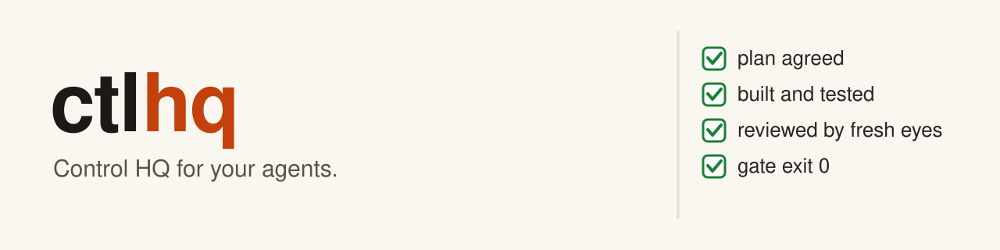

# ctlhq

ctlhq is a set of skills, playbooks, a subagent definition, and small command-line tools for Claude Code and Codex.
A skill tells the agent how to do one kind of job, such as fixing a bug, reviewing a change, or running a long task overnight.

Why: coding agents move fast but skip steps. They claim "done" without proof, drift from the plan, and repeat the same mistakes.
ctlhq gives them fixed methods with checks at each step, and turns the mechanical steps into commands the agent runs.

Start, from a clone of this repository:

```bash
bin/ctlhq-install && export PATH="$PWD/bin:$PATH"
```

Then, in a new Claude Code session, type `/ctlhq-setup`, then `/ctlhq-mode` and your task.
ctlhq runs on macOS only, for now.
It is provided as is, without warranty; see [LICENSE](./LICENSE).

## Contents

1. [How it works](#how-it-works)
2. [Requirements](#requirements)
3. [Install](#install)
4. [What it changes on your machine](#what-it-changes-on-your-machine)
5. [Uninstall](#uninstall)
6. [Using it](#using-it)
7. [Reporting problems](#reporting-problems)
8. [Credits](#credits)
9. [License](#license)

## How it works

In this README, the operator is the person who directs the agents. That is you.

1. You type `/ctlhq-mode` and a task, such as "fix the duplicate rows in the export; repro first".
2. `/ctlhq-mode` matches the task to a playbook, a numbered list of steps such as "Bug fix" or "Feature".
3. It copies the steps into the agent's todo list and runs other skills when a step needs them, such as `/architect` before code or `/blind-review` before a commit.
4. Steps with a mechanical part call a tool in `bin/`, such as `ctlhq-run-gate` for the project's checks or `ctlhq-commit` for the commit sequence.
5. Coding principles (24 short skills, such as `principle-prove-it-works`) set the bar for each choice, and the reply names the ones it applied.

The repository holds these folders:

```
skills/<name>/       one skill per folder; ctlhq-mode also holds the playbooks
bin/                 the command-line tools; add this folder to PATH
agents/              subagent definitions for Claude Code
home/AGENTS.md       optional shared working rules for agents
docs/principles.md   the building principles behind ctlhq
```

## Requirements

Required:

1. `git` and `bash`.
2. `python3`, version 3.9 or newer.
3. `node`, version 22.18 or newer, for `ctlhq-plan-lint` (the plan checker), `ctlhq-browser`, `ctlhq-icon-sheet`, and the tests of those three and of the stand-ins (the fakes the tests use in place of outside tools).

Optional:

1. `bun`, for `ctlhq-orch` and `ctlhq-watch-pr`. Their first run installs packages with `bun install`, which downloads them over the network.
2. `gh` (the GitHub command-line tool), for `ctlhq-watch-pr`, the pull-request column of `ctlhq-worktree-audit`, and the pull-request playbooks.
3. `rg` and `jq`, for `ctlhq-worktree-audit`.
4. `gitleaks`, for a fuller secret scan in `ctlhq-first-push`. It looks in `~/.ctlhq/bin/` first, then on your PATH. Without it, `ctlhq-first-push` checks only its built-in token patterns.
5. Google Chrome, for `ctlhq-browser`, `ctlhq-icon-sheet`, and their tests.
6. `skill-creator`, the skill for writing skills, used by `/automate-me`, `/reflect`, and the "Authoring or modifying a skill" playbook. Codex ships it. On Claude Code, install it with `/plugin install skill-creator@claude-plugins-official`.
7. first-commit, a separate tool, only for `/start-project` and `/run-method`. It creates a new project's Git repository and installs its Git hooks. Get it from `https://github.com/amrendra18/first-commit`.

`bin/ctlhq-doctor` checks every tool above except `gitleaks` and `skill-creator`, and prints an install line for each missing one.
It also checks the PATH line and the models file.

## Install

Read [What it changes on your machine](#what-it-changes-on-your-machine) first.
The installer copies no files.
It makes links (symbolic links) in the folders Claude Code and Codex read, and each link points back into your clone.
So keep the clone where you made it.

1. Clone the repository and go into it. Use the clone address from the repository's GitHub page.

   ```bash
   git clone https://github.com/amrendra18/ctlhq.git ~/ctlhq
   cd ~/ctlhq
   ```

2. Preview the install. `--dry-run` prints every link it would make and changes nothing.

   ```bash
   bin/ctlhq-install --dry-run
   ```

3. Install. If a real file or folder already sits where a link should go, the installer leaves it in place, says so, and exits with code 1. Run it again with `--replace` to move such files to `~/.ctlhq-backups/` first.
   The installer also removes its own old links, such as one for a skill renamed since an earlier install. A link counts as its own old link only when all four hold: the link holds an absolute path, that path names an item directly inside the clone's `skills/` or `agents/` folder, that folder exists, and the item is gone. It prints one `remove stale` line for each. It never touches any other link: a relative link, a link deeper inside the clone, or a link that points elsewhere.

   ```bash
   bin/ctlhq-install
   ```

4. Add `bin/` to your PATH, so the tools run by name. Near the end of its output, the installer prints a line labelled `PATH line`. Copy the part of that line that starts with `export PATH=`; it holds your clone's full path. Paste it at the end of `~/.zshrc`, then open a new terminal window.

5. Check the result in the new window. `--check` reports any missing, wrong, or stale link and changes nothing. A `stale` link is an old link the installer would remove; run `bin/ctlhq-install` again to remove it. `ctlhq-doctor` reports any missing tool. At this step it may list optional tools and `models.toml` as not ok; step 6 writes `models.toml`.

   ```bash
   ctlhq-install --check
   ctlhq-doctor
   ```

6. Start a new Claude Code or Codex session and run `/ctlhq-setup` (`$ctlhq-setup` in Codex). It asks for a reasoning budget and writes `~/.ctlhq/models.toml`, which names the model for each role.

**Shared rules file (optional).** `home/AGENTS.md` holds the maintainer's working rules for agents, for every project.
They cover how agents write replies and how they run a project.
For example, the agent restates your ask and waits for your yes, keeps a `PLAN.md` with your approvals, and commits only through `ctlhq-commit` after the project's checks pass.
Agents that follow these rules create `PLAN.md`, `BLOCKED.md`, and `.local/` in the projects they work on.
Read the file before you use it.

1. `ctlhq-install --agents-md` writes `~/.codex/AGENTS.md`, the file Codex reads as your global rules. If you already have that file, the installer leaves it in place and exits with code 1. Add `--replace` to move your file to `~/.ctlhq-backups/` first.
2. To give Claude Code the same rules, add the line `@~/.codex/AGENTS.md` to `~/.claude/CLAUDE.md` yourself. The installer never touches that file.
3. To stop using the rules, delete the line `agents_md = true` from `~/.ctlhq/layers.toml`, then run `ctlhq-install` again. That install copies `~/.codex/AGENTS.md` to `~/.ctlhq-backups/`, then removes it.

**Your own skills in a second folder (optional).** Keep private skills in their own folder, with the same `skills/`, `agents/`, and `home/` layout.
Add a `layers` line that lists both folders to `~/.ctlhq/layers.toml`, then run the installer again.
It links the skills of every listed folder side by side, and refuses a name that appears in two folders.
`ctlhq-install --help` describes the file.

```toml
layers = ["~/ctlhq", "~/my-skills"]
```

## What it changes on your machine

The installer writes links. Only when you ask, it also writes a rules file, one settings line, and backups.
It never edits `~/.claude/settings.json`, `~/.zshrc`, or any other shell file.
It prints the lines for those files, and you decide whether to add them.

Written by `bin/ctlhq-install`:

| # | Path | What goes there | When |
| --- | --- | --- | --- |
| 1 | `~/.claude/skills/<name>` | a link to each skill folder | every install |
| 2 | `~/.codex/skills/<name>` | a link to each skill folder | every install |
| 3 | `~/.agents/skills/<name>` | a link to each skill that a layer's `docs/install.tsv` sends to the `agents` host | only for such a skill; this repository has no such file |
| 4 | `~/.claude/agents/<name>.md` | a link to each subagent definition (`ctlhq-agent`) | every install |
| 5 | `~/.codex/AGENTS.md` | a generated file, with a marker line and then the `home/AGENTS.md` of each layer, in layer order | only with `--agents-md` |
| 6 | `~/.ctlhq/layers.toml` | the line `agents_md = true`, so later installs keep the rules file up to date | only with `--agents-md`, once the rules file is written |
| 7 | `~/.ctlhq-backups/<date>/` | your own files that `--replace` moved aside, and the rules file that `--uninstall` or a later install removed | only with `--replace`, with `--uninstall`, or on the first install after you delete `agents_md = true` |

Written by other tools, only when you run them:

| # | Path | What goes there | Written by |
| --- | --- | --- | --- |
| 1 | `~/.ctlhq/models.toml` | the model for each role | `/ctlhq-setup` or `ctlhq-models init` |
| 2 | `~/.ctlhq/first-push.toml` | `github_owner`, the only GitHub account that `ctlhq-push` and `ctlhq-first-push` accept | you, by hand |
| 3 | `.git/hooks/pre-push` in one repository | a hook that runs `ctlhq-first-push` before each push; an existing hook is kept as `pre-push.before-first-push` and still runs first | `ctlhq-first-push hook install` |
| 4 | `.local/catalog/` in your clone | the catalog of skills, agents, and tools | `ctlhq-catalog build` or `ctlhq-catalog open` |
| 5 | `skills/ctlhq-mode/scripts/node_modules/` in your clone | the packages of `ctlhq-orch` and `ctlhq-watch-pr` | `bun install`, on their first run |

Suggested, never applied for you:

1. **The Stop hook.** The installer prints a Stop hook entry for `~/.claude/settings.json`. Once you add it, `ctlhq-reply-lint` checks every Claude Code reply, in every project. When a reply breaks a blocking rule, such as a long dash, a missing "next step" line, or too many words, the hook sends the findings back and the agent rewrites the reply. The hook fires at most once per reply. It also sends two warnings, at most once per operator message. One is a finished item reported while `PLAN.md` names a next step. The other is a repeated "next step" line with no new fact. `ctlhq-reply-lint --help` lists every rule. Leave the hook out if you do not want these rules in every project.

   Codex has the same hook. The installer does not print it, so add it by hand to `~/.codex/hooks.json`, under `"hooks"`. If the file does not exist, create it as `{"hooks": {...}}` with the entry below inside. If it already has a `"Stop"` key, add the entry's inner `{"hooks": [...]}` object to that `"Stop"` list. Codex runs a new hook only after you trust it once, when Codex asks you to review hooks. For a clone in `~/ctlhq`, with your home folder in place of `<home>`, the entry is this one:

   ```json
   "Stop": [{"hooks": [{"type": "command", "command": "<home>/ctlhq/bin/ctlhq-reply-lint --hook-json", "timeout": 5}]}]
   ```

2. **The push guard.** `ctlhq-preflight --push-guard` prints `sudo git config --system` commands that add push rules to the system Git settings. It never runs them.

Read by tools:

1. `ctlhq-transcripts` reads your local agent transcripts in `~/.claude/projects` and `~/.codex/sessions`. The skills `reflect`, `show-me-your-work`, `automate-me`, and `run-method`, and the Session pickup and Eval playbooks, call it. By default it reads only the current workspace's transcripts. The `recall` skill reads the same folders directly. The tool makes no network calls, but the text it prints goes into the agent's context, like any file the agent reads.
2. `ctlhq-worktree-audit` searches the Claude Code transcripts of the audited repository and of each worktree (`~/.claude/projects/<folder>/`), and every Codex session on the machine (`~/.codex/sessions/`), for each worktree's path. It prints only the date of the newest match.
3. The Stop hook, once you add it, reads the current session's transcript and the project's `PLAN.md` and `BLOCKED.md`. It needs them to decide its two warnings. It also writes one small marker file per warning sent, under `ctlhq-reply-lint/sent/` in your temporary folder, so each warning goes out once.

Network use:

1. `ctlhq-orch` and `ctlhq-watch-pr` download their packages with `bun install` on first run. `bin/ctlhq-test` does the same once when bun is installed and the packages are missing.
2. `ctlhq-watch-pr`, `ctlhq-worktree-audit`, and the pull-request playbooks call GitHub through `gh`. `ctlhq-worktree-audit` also runs `git fetch origin` for an `origin/` base branch, the default, unless you pass `--no-fetch`.
3. `ctlhq-push` pushes to GitHub, and only to repositories of the owner in `~/.ctlhq/first-push.toml`.
4. `ctlhq-dep-age` asks the npm, PyPI, Go, and crates.io registries for release dates.
5. `ctlhq-name-check --registry` asks npm and PyPI whether a name is taken.
6. `ctlhq-env` with the `tart` provider downloads the machine image a recipe in `envs/` names.
7. `ctlhq-preflight --service`, `ctlhq-serve`, and `ctlhq-browser` request only the URLs you give them.

**Test machine drivers.** The `tart` and `utm` providers of `ctlhq-env` are untested on a real machine; only fake stand-ins of `tart` and `utmctl` have run them.
`ctlhq-env restore` with `tart` runs `tart delete` on the virtual machine (VM) the recipe names, then clones it back from the snapshot.
`ctlhq-env snapshot` with `tart` deletes an earlier snapshot with the same tag.
So these commands can remove a VM of yours that has a recipe's name, such as `ubuntu`. Use these providers only with VMs you can lose.

## Uninstall

1. Preview, then remove the links and the generated rules file:

   ```bash
   ctlhq-install --uninstall --dry-run
   ctlhq-install --uninstall
   ```

   The uninstall removes the links for every skill and subagent this version ships, when they point into this repository (or another folder in your layers file). It also removes `~/.codex/AGENTS.md` when ctlhq generated it, after a copy to `~/.ctlhq-backups/`. It also removes each stale link: an absolute link to an item directly inside the repository's `skills/` or `agents/` folder that no longer exists, such as one for a skill renamed since you installed. It keeps every real file and every link that points elsewhere. It lists, as `left`, any other link into the repository under a name this version does not ship. Delete those links yourself.

2. If you added the line `@~/.codex/AGENTS.md` to `~/.claude/CLAUDE.md`, delete it. The uninstall prints this reminder when it removes the rules file.

3. Remove by hand what the uninstall leaves:
   1. the PATH line in `~/.zshrc`;
   2. the Stop hook entry in `~/.claude/settings.json`, and the one in `~/.codex/hooks.json` if you added it;
   3. a pre-push hook from `ctlhq-first-push hook install`. In that repository, delete `.git/hooks/pre-push`, then rename `.git/hooks/pre-push.before-first-push` back to `pre-push` if it exists;
   4. `~/.ctlhq-backups/`, after you restore what you want from it (the uninstall does not move backed-up files back);
   5. `~/.ctlhq/`, which holds the models file, the layers file, the push settings, and `bin/gitleaks` if you put it there;
   6. the folders `~/.claude/skills`, `~/.claude/agents`, and `~/.codex/skills`, if the install created them and they are now empty;
   7. the clone itself.

## Using it

In Codex, type a dollar sign in place of the slash for every skill, such as `$ctlhq-mode`.

1. Type `/ctlhq-mode` and your task at the start of any task that needs rigor. Say the goal and how you will know it is done. You do not need to name a playbook or list skills.

   ```text
   /ctlhq-mode add a --json flag to this command. text output stays byte-identical. verify both.
   ```

2. Type `/ctlhq-help` and a question when you are not sure which skill fits. It answers and hands you a prompt to send. It starts no work.
3. Run `ctlhq-catalog open` to see every skill, agent, and tool in a browser, with what each does and when to use it. `ctlhq-skills find <word>` searches the skills in the terminal, `ctlhq-playbook list` prints the playbooks, and `ctlhq-principles` prints the coding principles.
4. Read [docs/principles.md](./docs/principles.md) for the building principles behind ctlhq's skills and tools.

The skills you are most likely to type yourself:

| # | skill | use it when |
| --- | --- | --- |
| 1 | `/ctlhq-mode` | any task that needs rigor; it picks the playbook and the other skills |
| 2 | `/ctlhq-help` | you are not sure which skill, playbook, or principle fits |
| 3 | `/ctlhq-setup` | you want to pick which model ctlhq uses for each role |
| 4 | `/start-project` | you bring a new idea; it ends with an approved `PLAN.md` |
| 5 | `/run-method` | you want a project built, reviewed, or finished end to end against that plan |
| 6 | `/blind-review` | you want a change, plan, or report reviewed by a fresh agent that did not write it |
| 7 | `/project-audit` | you want a whole repository or pull request reviewed through product, security, reliability, and test lenses |
| 8 | `/first-push` | you are about to push a repository to GitHub for the first time, or make one public |

Every tool in `bin/` answers `--help`.
To change ctlhq itself, read [CONTRIBUTING.md](./CONTRIBUTING.md).

## Reporting problems

1. Bugs and questions: open an issue on the repository's GitHub page. Include your host (Claude Code or Codex), your macOS version, and the output of `ctlhq-doctor`.
2. Security problems: do not open a public issue. Follow [SECURITY.md](./SECURITY.md).

## Credits

ctlhq's coding principles and some of its skills are adapted from [pstack](https://github.com/cursor/plugins/tree/main/pstack) 0.15.25 by Lauren Tan ([poteto](https://github.com/poteto)), MIT license. Thanks to pstack for the idea behind them: "if you want to go fast, go deep first." pstack's copyright notice is kept in [LICENSE](./LICENSE).

## License

MIT. See [LICENSE](./LICENSE).
